<p align="center">
  
</p>

<p align="center">
  <a href="https://github.com/soakes/telegram-message-exporter/actions/workflows/build-and-validate.yml"></a>
  <a href="https://www.python.org/downloads/"></a>
  <a href="https://macos.telegram.org/"></a>
  <a href="LICENSE"></a>
  <a href="https://buymeacoffee.com/soakes"></a>
</p>

---

**telegram-message-exporter** recovers chats from the encrypted cache that
Telegram for macOS keeps on disk. When a chat has been deleted from Telegram,
that cache can be the last copy left on the Mac. The tool decrypts it and
writes the messages out as HTML, Markdown or CSV, along with any attachments
that are still cached.

It works entirely offline. It never contacts Telegram or any other service,
and it never writes anything back into the app.

It supports the native Telegram for macOS app, the one from
[macos.telegram.org](https://macos.telegram.org/) or the Homebrew `telegram`
cask. The Mac App Store build, Telegram Desktop (the cross-platform Qt app),
phone backups and Telegram's own data export all store messages differently,
and none of them will work here.

> **Unofficial tool, not affiliated with [Telegram](https://telegram.org).**

**Quick links:** [Install](#install) · [Find the files](#find-the-telegram-files) · [Decrypt](#decrypt-the-database) · [Export](#export-a-chat) · [Troubleshooting](#when-it-doesnt-work) · [Development](#development)

---

## Before you start

If you are trying to save a chat that was deleted recently, move quickly. Quit
Telegram and take the Mac offline so the app has less chance to sync the
deletion or overwrite its cache.

Then copy Telegram's whole `stable` folder and work from the copy. Telegram
keeps its database in SQLite's WAL mode, so the newest changes can sit in
`db_sqlite-wal` next to `db_sqlite`, and copying the database file on its own
can leave them behind. The folder includes the media cache, so it can be large.

```bash
STABLE="$HOME/Library/Group Containers/6N38VWS5BX.ru.keepcoder.Telegram/stable"
mkdir -p recovery
cp -Rp "$STABLE" recovery/telegram
```

If macOS asks whether your terminal may access data from other apps, allow it.
If `cp` fails with `Operation not permitted` instead, give the terminal app Full
Disk Access in System Settings > Privacy & Security > Full Disk Access, restart
it, and run the copy again.

The decrypted database and every export contain your messages in plain text.
Keep them somewhere private and delete them when you are finished.

## Install

You need Python 3.11 or newer.

```bash
python3 -m venv .venv
source .venv/bin/activate
pip install "git+https://github.com/soakes/telegram-message-exporter.git"
```

If `pip` fails while building `sqlcipher3`, install SQLCipher with
`brew install sqlcipher` and try again.

## Find the Telegram files

`discover` prints the key file and, for each account, the database and media
cache it finds. It then prints ready-to-run `decrypt` and `export` commands for
the first account, so you rarely need to type a path yourself. Point `--root`
at your copy, or leave it out to look in Telegram's own folder:

```console
$ telegram-exporter discover --root recovery/telegram
Telegram root: recovery/telegram
Encrypted key: recovery/telegram/.tempkeyEncrypted
Raw key: not found

Account 1: account-123456
  Messages DB: recovery/telegram/account-123456/postbox/db/db_sqlite
  Media dir: recovery/telegram/account-123456/postbox/media

Suggested decrypt command:
  telegram-exporter decrypt \
    --key recovery/telegram/.tempkeyEncrypted \
    --db recovery/telegram/account-123456/postbox/db/db_sqlite \
    --out recovery/plaintext.db

Suggested HTML export with cached media:
  telegram-exporter export \
    --db recovery/plaintext.db \
    --media-dir recovery/telegram/account-123456/postbox/media \
    --format html \
    --out recovery/chat.html
```

The suggested export covers every chat. To export one, add a peer as described
under [Export a chat](#export-a-chat). The layout `discover` looks for is:

```text
~/Library/Group Containers/6N38VWS5BX.ru.keepcoder.Telegram/stable/
├── .tempkeyEncrypted
└── account-<id>/
    └── postbox/
        ├── db/
        │   ├── db_sqlite
        │   └── db_sqlite-wal
        └── media/
```

`.tempkeyEncrypted` starts with a dot, so plain `ls` hides it; use `ls -a`.
Each `account-*` folder is a separate Telegram account with its own database.

## Decrypt the database

```bash
telegram-exporter decrypt \
  --key recovery/telegram/.tempkeyEncrypted \
  --db recovery/telegram/account-123456/postbox/db/db_sqlite \
  --out recovery/plaintext.db
```

This writes an ordinary SQLite copy to `recovery/plaintext.db`. Every other
command reads from that copy. `decrypt` itself works on a temporary copy of
`db_sqlite` and its `-wal` file, so the folder you point it at is never changed.

If you use Telegram's Passcode Lock, the passcode is part of the key. Pass it
with `--passcode`, or set `TG_LOCAL_PASSCODE` so it stays out of your shell
history:

```bash
read -rs TG_LOCAL_PASSCODE && export TG_LOCAL_PASSCODE
```

`--key` also accepts a raw `.tempkey` file if that is what you have.

## Export a chat

Find the chat first:

```console
$ telegram-exporter list-peers --db recovery/plaintext.db --search "Alex"
Possible peers:
  123456789  Alex Example  (table=t2)
```

Then export it:

```bash
telegram-exporter export \
  --db recovery/plaintext.db \
  --peer-id 123456789 \
  --format html \
  --media-dir recovery/telegram/account-123456/postbox/media \
  --out recovery/alex.html
```

`--contact "Alex"` works in place of `--peer-id` when only one peer matches. If
several do, the command lists them so you can choose an ID. Use
`--start-date` and `--end-date` (`YYYY-MM-DD` or an ISO timestamp) or `--limit`
to export part of a chat. Leave out the peer entirely to export every message
the tool can decode.

With `--media-dir`, attachments that are still in Telegram's cache are copied
to `recovery/alex_media/` and linked from the transcript. Anything that was
never downloaded to this Mac can't be recovered. The transcript still lists it,
with whatever details the database holds.

There are three formats:

- `html` is the one to read. You get a styled transcript with a summary, a jump
  list by date, and working links.
- `md`, the default, is plain text that suits archiving and diffs.
- `csv` puts one message on each row for spreadsheets or scripts. Attachment and
  forward details go in JSON columns.

Outgoing messages are labelled `Me` unless you set `--me-name`.

## Commands

| Command | What it does |
| --- | --- |
| `discover` | Prints the likely key, database and media paths |
| `decrypt` | Writes a plaintext SQLite copy of `db_sqlite` |
| `list-peers` | Searches the decrypted database for chats by name |
| `export` | Writes messages as HTML, Markdown or CSV |
| `diagnose` | Lists tables and columns, plus sample rows from one table |

`telegram-exporter <command> --help` lists every flag.

## When it doesn't work

| Message | Likely cause |
| --- | --- |
| `Failed to decrypt database` or `file is not a database` | The key and database come from different places, or Passcode Lock is on and no passcode was given |
| `Key file not found` / `Database file not found` | A wrong path, often an unquoted space in `Group Containers` |
| `Permission denied` or `Operation not permitted` | macOS is blocking the terminal from reading Telegram's data; give it Full Disk Access in System Settings > Privacy & Security, then restart it |
| `No peer records found` | The database probably isn't from the native macOS app; run `diagnose` and check |
| `No messages found with the current filters` | Drop the date filters and check the peer ID |
| `sqlcipher3` fails to install | Install SQLCipher with Homebrew and reinstall in a fresh virtual environment |

`--debug` on `decrypt` shows whether the key file parsed and which key and
SQLCipher profile worked. On `export` it prints the SQL, key ranges and query
plans to stderr. `diagnose --db recovery/plaintext.db` dumps the table layout,
which helps if Telegram has changed its storage format.

This tool only reads what is still in the local cache. It can't bring back
messages the app has already discarded, it can't get past a passcode you don't
know, and some newer or unusual message types decode only partly. If you find
one of those, please open an issue, but never attach a database or a
transcript.

## Development

```bash
pip install -e '.[dev]'
black --check src/telegram_message_exporter tests telegram_exporter.py .github/scripts
ruff check src/telegram_message_exporter tests telegram_exporter.py .github/scripts
pylint src/telegram_message_exporter telegram_exporter.py
pytest -q
```

The `dev` extra pins the same tool versions that CI uses. Build and Validate
runs these checks on Python 3.11 to 3.15 and also builds the package.
Dependabot keeps the pins current, and its pull requests are merged
automatically once they pass.

The version lives in [`VERSION`](VERSION). To change it, run
`.github/scripts/bump_version.py patch`, `minor` or `major`, or pass
`--set 1.2.3`.

The banner at the top of this page and the social card are generated. Edit the
copy, layout or timing in `scripts/readme/build_readme_hero.py` and run
`make readme-hero`. That rebuilds
`assets/telegram-message-exporter-readme-hero.svg` and
`assets/telegram-message-exporter-social-card.png`, which is the image for
GitHub's social preview and is uploaded by hand in the repository settings. It
runs the script with `uv`, which installs the pinned fontTools it subsets the
fonts with, and renders the card with headless Chrome or Chromium. The fonts
come from assets.netspeedy.io, so the first run needs network access. If you
change the headline's words, measure them again with
`uv run scripts/readme/measure_headline.py`.

## Credits

This project builds on community reverse-engineering work. Special thanks to
[@stek29](https://github.com/stek29) for the original research and
[reference implementation](https://gist.github.com/stek29/8a7ac0e673818917525ec4031d77a713)
of the Telegram for macOS local key format and Postbox structure.

Thanks to [@ivankruchkoff](https://github.com/ivankruchkoff) for reporting and
contributing support for raw `.tempkey` files, and to
[@0x241](https://github.com/0x241) for the path discovery and media recovery
ideas behind the `discover` command.

## License

MIT. See [LICENSE](LICENSE).
